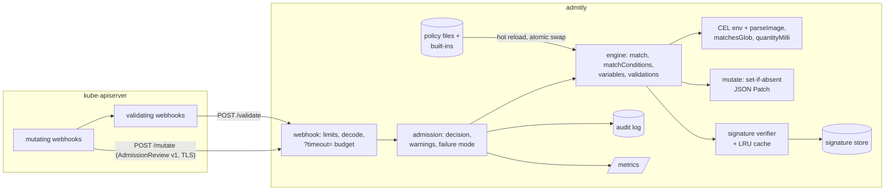

# admitly

A Kubernetes validating + mutating admission webhook with a CEL policy engine,
Audit vs Enforce modes, a built-in security policy library, securityContext
defaulting, and cosign-compatible image signature verification. Written in Go,
tested against golden AdmissionReview v1 fixtures and a real kube-apiserver
(envtest).

> Status: a portfolio / lab project. It has not been run on a production
> cluster. See [Limitations](#limitations).

## What and why

Admission control is where a cluster says no: no privileged pods, no images
from random registries, no unsigned builds. The usual tools (Kyverno, OPA
Gatekeeper, and the in-tree ValidatingAdmissionPolicy) are large. admitly is a
small, readable implementation of the same core ideas, built to show how the
pieces work and where they fail:

- **Policies as CEL**, in a ValidatingAdmissionPolicy-like YAML shape
  (`match`, `matchConditions`, `variables`, `validations`), compiled and
  type-checked before they go live, with a runtime cost limit.
- **Audit vs Enforce** per policy: Audit admits the request but returns a
  Warning header and an audit annotation, so a policy can be rolled out by
  watching what it would have blocked.
- **Built-in policies**: no privileged containers/host namespaces, required
  labels, resource limits (with a max-memory cap), registry allow-list, image
  digest pinning.
- **Mutation**: hardened `securityContext` defaults (runAsNonRoot,
  RuntimeDefault seccomp, no privilege escalation, drop ALL capabilities),
  only where the workload did not set a value.
- **Image signature verification** against configured public keys using the
  cosign simple-signing payload format (ECDSA, Ed25519, RSA).
- **Explicit failure behaviour**: per-policy `failurePolicy`, a global
  fail-open/closed mode for deadlines and internal errors, and tests that
  exercise the API server's own `failurePolicy` with the webhook down.

Who it's for: platform/security engineers who want to understand or prototype
admission policy, and reviewers looking for a compact, tested reference.

## Architecture



Deeper design, algorithms and complexity: [docs/ARCHITECTURE.md](docs/ARCHITECTURE.md).
Threats and failure modes: [docs/THREAT_MODEL.md](docs/THREAT_MODEL.md).
Rulings and trade-offs: [DECISIONS.md](DECISIONS.md).

## Quickstart

Requirements: Go 1.27+, `golangci-lint` v2 for `make lint`. No Docker, no
network and no cluster needed for `make check` and `make demo`.

```bash
make build                 # bin/admitly
make check                 # fmt, vet, lint, race tests, coverage >= 80%, envtest if assets are installed
make demo                  # offline end-to-end demo (below)
make envtest               # real kube-apiserver + etcd suite (downloads assets once)
make bench                 # latency benchmarks
```

Evaluate manifests offline with the same code path the webhook uses (mutate,
apply patch, validate). It exits 1 if anything is denied, so it can gate CI:

```bash
bin/admitly eval examples/manifests/pods.yaml
bin/admitly eval --policies my-policies/ --store signatures/ --output json deploy.yaml
```

Run the webhook:

```bash
bin/admitly certs --hosts admitly.admitly-system.svc --out certs
bin/admitly serve --config examples/admitly.yaml
```

In-cluster manifests (lab use, not tested on a real cluster): `deploy/admitly.yaml`
and `deploy/webhooks.yaml`.

## Writing a policy

```yaml
apiVersion: admitly.dev/v1alpha1
kind: ValidationPolicy
metadata:
  name: registry-allowlist
spec:
  mode: Enforce                # or Audit / Disabled
  failurePolicy: Fail          # what an evaluation error means
  match:
    resources:
      - apiGroups: [""]
        kinds: [Pod]
        subresources: ["", ephemeralcontainers]   # also catch `kubectl debug`
      - apiGroups: [apps]
        kinds: [Deployment, StatefulSet, DaemonSet, ReplicaSet]
    excludeNamespaces: [kube-system]
  params:
    allowedImages: [registry.lab.local/**]
  variables:
    - name: disallowed
      expression: >-
        containers.filter(c, !params.allowedImages.exists(p,
          parseImage(c.image).name.matchesGlob(p))).map(c, c.image)
  validations:
    - expression: size(variables.disallowed) == 0
      messageExpression: "'images from unapproved registries: ' + variables.disallowed.join(', ')"
```

`containers`, `podSpec` and `podMeta` are extracted for Pods and the seven
workload kinds, so one expression covers Deployments and CronJobs too. Image
verification and mutation have their own kinds; see `policies/builtin/` and
`examples/policies/`. Built-ins can be tuned without copying them:

```yaml
policies:
  builtin: true
  overrides:
    require-labels: {mode: Audit}
    registry-allowlist: {params: {allowedImages: ["registry.lab.local/**", "docker.io/library/*"]}}
```

## Demo

`make demo` (from `scripts/demo.sh`) generates a lab key and TLS material,
signs three images, lints the policies, evaluates `examples/manifests/pods.yaml`
offline, then starts the real HTTPS webhook and sends it AdmissionReviews with
curl. Excerpt from a real run (full output in the build report):

```text
==> 4. Offline evaluation of examples/manifests/pods.yaml (mutate -> validate)
Pod shop/checkout (CREATE)  [examples/manifests/pods.yaml]
  mutate:   2 patch operation(s) by default-security-context
            add /spec/securityContext {"runAsNonRoot":true,"seccompProfile":{"type":"RuntimeDefault"}}
            add /spec/containers/0/securityContext {"allowPrivilegeEscalation":false,"capabilities":{"drop":["ALL"]}}
  validate: ALLOWED

Pod shop/debug-shell (CREATE)  [examples/manifests/pods.yaml]
  mutate:   2 patch operation(s) by default-security-context
            add /spec/securityContext {"runAsNonRoot":true,"seccompProfile":{"type":"RuntimeDefault"}}
            add /spec/containers/0/securityContext/capabilities {"drop":["ALL"]}
  validate: DENIED (HTTP 403 Forbidden)
            deny  [disallow-privileged] privileged containers are not allowed: shell
            deny  [disallow-privileged] sharing host namespaces is not allowed: hostPID
            deny  [registry-allowlist] images from unapproved registries: docker.io/library/busybox:1.36
            deny  [require-image-digest] images must be pinned by digest: docker.io/library/busybox:1.36
            deny  [require-labels] missing required labels: team
            deny  [require-resource-limits] containers must set cpu and memory limits: shell

Pod shop/unsigned (CREATE)  [examples/manifests/pods.yaml]
  ...
  validate: DENIED (HTTP 403 Forbidden)
            deny  [verify-images] image signature verification failed: registry.lab.local/shop/unsigned@sha256:9b2a...c7b6: no signatures found

Deployment shop/storefront (CREATE)  [examples/manifests/pods.yaml]
  ...
  validate: DENIED (HTTP 403 Forbidden)
            deny  [require-resource-limits] memory limit above 4Gi: web

4 object(s): 1 allowed, 3 denied

==> 6. POST testdata/golden/validate-audit-latest-tag.request.json -> /validate
{
  "uid": "11111111-0000-0000-0000-000000000005",
  "allowed": true,
  "warnings": [
    "[audit] disallow-latest-tag: containers use the latest tag: app"
  ],
  "auditAnnotations": {
    "audit-violations": "[{\"policy\":\"disallow-latest-tag\",\"mode\":\"Audit\",\"severity\":\"low\",\"reason\":\"Forbidden\",\"message\":\"containers use the latest tag: app\"}]"
  }
}

==> 7. Hot reload: switch disallow-latest-tag from Audit to Enforce without a restart
{
  "uid": "11111111-0000-0000-0000-000000000005",
  "allowed": false,
  "status": {
    "code": 403,
    "reason": "Forbidden",
    "message": "admitly denied the request: [disallow-latest-tag] containers use the latest tag: app"
  }
}

==> 8. Malformed requests are rejected before evaluation
wrong content type -> HTTP 415
v1beta1 review     -> HTTP 400
untrusted client   -> TLS verification failed (expected: client does not trust the webhook CA)
```

(The `unsigned` digest is shortened here for width; everything else is verbatim.)

## Testing

| What | Where | Command |
|---|---|---|
| Unit tests per package (parser, CEL functions, policy loader, matcher, patch generator, verifier, TLS, config) | `internal/*/..._test.go` | `make test` |
| **Golden AdmissionReview v1**: 15 request/response pairs replayed through the HTTP handler (validate + mutate, Pods, Deployment, CronJob, ephemeral containers, DELETE, kube-system exemption) | `testdata/golden/`, `internal/server/golden_test.go` | `make test`; regenerate with `make golden` |
| **envtest**: admitly registered with a real kube-apiserver/etcd using generated TLS; mutation applied by the API server, 403 denials, audit warnings via Warning headers, `kubectl debug` path, caBundle mismatch, API-server `failurePolicy` Fail vs Ignore with the webhook down | `test/envtest/` | `make envtest` |
| **Fail-open / fail-closed**: slow policy + 50 ms deadline under both modes, API-server `?timeout=` budget, undecodable objects | `internal/server/server_test.go` | `make test` |
| **Property test**: 2,000 random pods; emitted JSON Patch applied with an independent RFC 6902 library equals the in-place result, and re-mutation is a no-op | `internal/mutate/mutate_test.go` | `make test` |
| **Fuzzing**: image reference round-trip; HTTP handler never panics and always echoes the UID | `FuzzParse`, `FuzzValidateHandler` | `make fuzz` |
| **Interop**: signatures made by the `openssl` CLI (the same ASN.1/SHA-256 scheme `cosign sign-blob` uses) verify, and vice versa | `TestOpenSSLInterop` | `make test` (skips without openssl) |
| Deploy manifests strict-decoded into typed Kubernetes objects | `test/manifests/` | `make test` |

Results from the run recorded in the build report:

- `make check`: all gates passed; statement coverage of `internal/...` + `policies` **91.6%**
  (threshold 80%, measured by `scripts/coverage.sh` over a `-coverpkg` profile).
- `scripts/count-tests.sh`: 135 tests (including subtests) passed, 0 failed,
  0 skipped (default build; the envtest suite is counted separately).
- `make envtest`: 10/10 subtests passed against kube-apiserver 1.37.0.
- Fuzzing found three real bugs, each kept as a regression seed under
  `testdata/fuzz/`: two image-reference canonicalisation errors (an upper-case
  host without a dot; the 255-character limit checked before normalisation)
  and trailing bytes after the AdmissionReview being silently ignored.

## Benchmarks

All numbers are from `make bench` on an Apple M1 Pro (8 cores, Go 1.27.1)
**while other heavy builds were running on the same machine**, so treat them
as rough; re-run locally for your own numbers.

End-to-end over HTTPS on loopback (`bin/admitly bench --requests 5000 --concurrency 8 --warmup 500`),
in-process server with the 6 built-in policies plus a signature-verification
policy; latency measured by the client per request:

| scenario | endpoint | p50 | p90 | p99 | max | req/s |
|---|---|---|---|---|---|---|
| compliant pod (6 policies incl. signature) | validate | 348µs | 800µs | 1.504ms | 4.9ms | 17,650 |
| violating pod (5 policies deny) | validate | 293µs | 702µs | 1.11ms | 2.374ms | 20,668 |
| deployment template | validate | 235µs | 602µs | 939µs | 1.592ms | 24,344 |
| pod securityContext defaults | mutate | 228µs | 609µs | 1.322ms | 3.889ms | 24,434 |

Micro-benchmarks (`go test -run '^$' -bench . -benchmem -benchtime 3000x ./internal/engine/ ./internal/server/`):

| benchmark | ns/op | B/op | allocs/op |
|---|---|---|---|
| engine: validate compliant pod | 126,924 | 26,828 | 519 |
| engine: validate violating pod | 59,906 | 32,353 | 642 |
| engine: mutate pod | 8,829 | 7,712 | 115 |
| engine: validate 50-container pod | 887,741 | 296,817 | 6,375 |
| HTTP handler (no TLS): validate | 101,232 | 47,214 | 709 |
| HTTP handler (no TLS): mutate | 40,938 | 27,121 | 242 |

The compliant-pod engine number varied between runs on the shared machine
(about 52-127 µs/op); the allocation counts are stable.

`go test -run '^$' -bench Comprehension -benchtime 5x ./internal/celenv/`
documents an upstream cel-go behaviour: with a runtime cost limit installed, a
comprehension over 10x more elements took ~60x longer (4.7 ms -> 286 ms for
1k -> 10k elements) versus ~10x without cost tracking (0.11 ms -> 1.1 ms).
admitly keeps the cost limit and relies on the request deadline as the hard
bound; see the threat model (T11).

## Design decisions (summary)

- VAP-shaped policies loaded from files, not CRDs: familiar syntax, no API
  server write access needed by the webhook.
- Case-sensitive strict decoding everywhere (`sigs.k8s.io/json`), as the API
  server does; `encoding/json`'s case-insensitive matching let a typo in a
  mutation default pass validation during development.
- Anchored component globs on parsed image names, never string prefixes.
- Sub-resource opt-in per rule, with the built-ins opting in to
  `pods/ephemeralcontainers`.
- Three failure knobs (API server `failurePolicy`, admitly `failureMode`,
  policy `failurePolicy`), all fail-closed by default; a deadline never blames
  one policy.
- Mutation is set-if-absent, CREATE-only, and avoids API-server-invalid
  combinations (privileged + allowPrivilegeEscalation=false).

The full list with costs is in [DECISIONS.md](DECISIONS.md).

## Limitations

- **Not production-tested.** Verified with unit/golden/fuzz tests and envtest
  (a real kube-apiserver and etcd, but no scheduler, kubelet or controllers).
  The `deploy/` manifests are schema-checked but were never applied to a
  cluster, and the Dockerfile has not been built.
- **Signatures come from a local directory, not a registry.** The store
  mirrors cosign's `sha256-<digest>.sig` layout and accepts records in the
  `cosign download signature` JSON shape, but admitly does not talk to OCI
  registries, so in a cluster you would have to distribute signature files
  yourself. Keyless (Fulcio/Rekor) verification, attestations and
  certificate-based identities are not supported.
- **"cosign-compatible" is tested indirectly.** The payload layout is pinned
  by a test and interop is proven with the `openssl` CLI using the same
  signature scheme as `cosign sign-blob`; the cosign binary itself was not
  available offline and was not used in tests. Encrypted cosign private keys
  cannot be used with `admitly sign`.
- **Tag-only images cannot be verified**: there is no registry to resolve a
  tag to a digest, so verification policies deny unpinned images.
- **No namespace-label selectors**: matching uses namespace names (globs) only,
  because the webhook does not read Namespace objects.
- **Workload coverage is a static table** of 8 kinds; pod templates inside
  custom resources are invisible to `podSpec`/`containers`.
- **CPU-exhaustion residual risk**: cel-go's cost tracker is quadratic for
  large comprehensions; the deadline bounds each request but a hostile object
  can still consume CPU up to it.
- Evaluation-error messages can reveal policy internals to the requester.
- The audit log is a local file/stdout with no rotation.
- Benchmarks were taken on a shared, busy laptop.

## Roadmap

- OCI registry signature fetching (with tag-to-digest resolution) behind the
  existing `signature.Store` interface.
- Namespace-label selectors via a cached Namespace informer.
- Policy unit-test files (`admitly test`) next to policies.
- Generic `MutationPolicy` patches beyond securityContext.
- Real-cluster smoke test (kind) as an opt-in `make integration` target.

## License

MIT, see [LICENSE](LICENSE). All test data is synthetic and generated in this
repository (see [DATA.md](DATA.md)).
