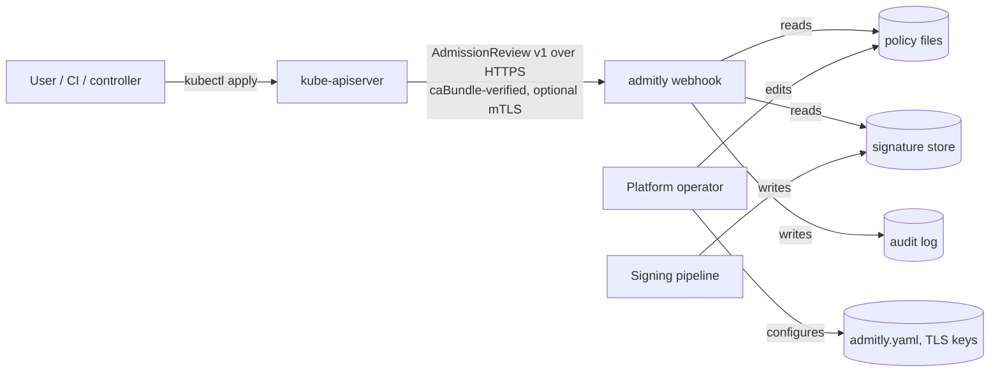

# admitly threat model

admitly is an admission webhook: the Kubernetes API server sends it every
matching create/update request and obeys its answer. That position makes it a
security control (it decides what may run) and a liability (if it is slow,
wrong or unavailable, the cluster's write path suffers). This document states
what admitly defends against, what it trusts, how it fails, and what it does
not cover. It is written for a lab/educational deployment; nothing here has
been tested on a production cluster.

## 1. System and trust boundaries

| Boundary | Trusted side | Untrusted side |
|---|---|---|
| API server -> admitly | admitly's TLS key, the caBundle in the webhook configuration | the *contents* of every AdmissionReview (objects are written by users) |
| Policy files -> admitly | operator who controls the policy directory/ConfigMap | - (policies are trusted code; see section 6) |
| Signature store -> admitly | public keys in policies | signature files (anyone who can write the store can add files; only key-holders can make them verify) |
| admitly -> audit log | file system | - |

## 2. Assets

1. **Admission decisions** - the integrity of "is this workload allowed?".
2. **Cluster write availability** - with `failurePolicy: Fail`, an unavailable webhook blocks matching writes.
3. **Signing keys** - out of scope for the webhook (it only holds public keys), but the lab `admitly keygen`/`sign` commands create unencrypted private keys.
4. **Webhook TLS private key** - lets an attacker impersonate admitly to the API server if stolen.
5. **Audit trail** - evidence of what was admitted under Audit mode.

## 3. Adversaries

| Adversary | Capability | Goal |
|---|---|---|
| A1: namespace user | create/update Pods and workloads in some namespaces, `kubectl debug` | run privileged/unvetted code, bypass policies |
| A2: supply-chain attacker | push images to a registry, possibly a look-alike registry host | get an unsigned or tampered image admitted |
| A3: network attacker in the cluster network | intercept/spoof traffic to the webhook Service | forge admission responses, read objects |
| A4: resource abuser | submit large or pathological objects | exhaust webhook CPU so requests fail open (or fail closed = DoS) |
| A5: confused policy author | write a broken or overly expensive policy | (accidentally) disable enforcement or stall admission |

Out of scope: cluster-admin (can delete the webhook configuration), node
compromise, compromised API server, compromised signing keys, and kernel or
container-runtime escapes after admission.

## 4. Threats and mitigations (STRIDE-style)

| # | Threat | Mitigation in admitly | Evidence (test) |
|---|---|---|---|
| T1 | **Privileged workload** via Pod, Deployment, CronJob... (A1) | `disallow-privileged` checks every container of the extracted pod spec for all 7 workload kinds; host PID/IPC/network denied | `TestBuiltinValidationMatrix`, `TestWorkloadKinds`, golden `validate-deployment-host-network` |
| T2 | **Policy bypass through `kubectl debug`** - ephemeral containers arrive via the `pods/ephemeralcontainers` sub-resource, which pod policies often never see (A1) | built-in privileged/registry/digest policies opt in to that sub-resource; the deploy manifest registers `pods/ephemeralcontainers` | `TestEphemeralContainersSubresource`, envtest "privileged ephemeral debug container is denied", golden `validate-ephemeral-debug-container` |
| T3 | **Look-alike registry** `registry.lab.local.evil.io/app` passing a prefix check (A2) | strict reference parser + anchored, per-component globs on the normalised name; no string-prefix matching anywhere | `TestMatchGlob`, golden `validate-lookalike-registry`, `TestCompileAndEvalBool` |
| T4 | **Ambiguous image references** parsed differently by admitly and the runtime (A2) | parser rejects anything ambiguous; fuzzed for canonical round-trip (two real bugs found and fixed, seeds kept) | `FuzzParse`, `TestParseRejects` |
| T5 | **Mutable tags** - the image reviewed is not the image run (A2) | `require-image-digest`; signature verification requires a digest and checks the signed payload's digest equals the pod's | `TestVerifyFailures` (digest mismatch), golden `validate-multi-violation` |
| T6 | **Unsigned / re-signed image** (A2) | ECDSA/Ed25519/RSA verification of cosign simple-signing payloads; payload must name the same repository *and* digest and have the cosign type string; any of the policy's keys must verify | `TestVerifyFailures` (wrong key, repo mismatch, tampered payload, wrong type), envtest "unsigned image is denied" |
| T7 | **Signature store tampering** (A2 with store write access) | store content is untrusted: adding files cannot create a valid signature without a private key; malformed files are an *infrastructure* error governed by the policy's failurePolicy; repository components are validated so store paths cannot traverse | `TestStoreErrors`, `TestImageVerificationStoreFailure` |
| T8 | **Forged webhook responses / eavesdropping** (A3) | HTTPS only, TLS >= 1.2; the API server verifies admitly's certificate against `caBundle`; optional mTLS (`clientCAFile`) so only the API server can call the webhook | `TestServeTLSAndMTLS`, envtest "API server rejects a webhook whose certificate does not chain to caBundle" |
| T9 | **Oversized or malformed requests** (A4) | 3 MiB body cap (413), strict content type (415), v1-only AdmissionReview, UID required, trailing bytes rejected (found by fuzzing), header/read/write timeouts | `TestHTTPErrors`, `FuzzValidateHandler` |
| T10 | **CPU exhaustion via expensive evaluation** (A4, A5) | per-expression CEL cost limit (default 1,000,000); every evaluation runs under a deadline (config `timeout`, further capped to 80% of the API server's `?timeout=`), and CEL checks for interruption every 100 iterations. The deadline only interrupts *between* comprehension iterations, so every custom native function must be bounded by construction: the quantity helpers cap strings at 128 characters and decide decimal exponents beyond 10^±1000 without `math/big` (`resource.Quantity.Cmp` on `1e100000000`, or even `ParseQuantity("1e-100000000")`, ran for 40+ s in one uninterruptible call) | `TestCostLimit`, `TestContextCancellation`, `TestAPIServerTimeoutParameterShortensDeadline`, `TestQuantityHugeExponents`, `TestParseQuantityMatchesKubernetes`, `FuzzQuantity` |
| T11 | **cel-go cost-tracker O(n^2)** - with a cost limit installed, comprehensions over n elements take time quadratic in n (measured: `make bench`, `BenchmarkComprehension`), so cost alone does not bound wall time on hostile objects (A4) | the deadline in T10 is the hard bound; the body cap limits n. Residual risk: an attacker who can create objects can make each request consume CPU up to the deadline | `BenchmarkComprehension`, `TestSlowPolicyInterruptedByDeadline` |
| T12 | **Fail-open abuse** - attacker slows admitly so that `failurePolicy: Ignore` admits everything (A4) | defaults are fail-closed everywhere (admitly `failureMode: Closed`, policy `failurePolicy: Fail`, deploy manifests `failurePolicy: Fail`); fail-open is an explicit, warned, annotated and audited choice | `TestFailClosedAndFailOpenOnDeadline`, envtest Fail vs Ignore |
| T13 | **Broken policy disables enforcement** (A5) | policies are compiled (type-checked) before activation; a failed reload keeps the previous set and is logged and counted (`admitly_policy_reloads_total{result="error"}`); unknown/miscased fields are rejected (case-sensitive strict decoding); typos in mutation defaults are rejected against the real Kubernetes types | `TestPolicyHotReload`, `TestParseRejects`, `TestMutationValidation` |
| T14 | **Mutation conflicts turning denials into confusing errors** | mutation never overwrites user values and skips `allowPrivilegeEscalation` for privileged/CAP_SYS_ADMIN containers and Linux fields for Windows pods | `TestPrivilegedContainerSkipsAllowPrivilegeEscalation`, property test |
| T15 | **Webhook blocks its own recovery** (self-deadlock) | deploy manifests exclude `kube-system` and `admitly-system` via `namespaceSelector`; 2 replicas + PDB | manifest strict-decode test |
| T16 | **Repudiation of Audit-mode findings** | every decision is a JSON line in the audit log (uid, user, violations incl. audit ones, failure reason, policy-set generation); audit violations also go to the API server audit log via `auditAnnotations` | `TestAuditLogRecords` |
| T17 | **Information disclosure in messages** | denial messages contain only policy names, container names and image references from the request itself; evaluation errors are reported as "policy could not be evaluated: <CEL error>", which can expose policy internals to the requester | accepted risk (lab use); see Limitations |

## 5. Failure behaviour

There are three independent knobs. Defaults are all fail-closed.

| Situation | Who decides | Default | Behaviour |
|---|---|---|---|
| admitly unreachable, TLS failure, non-200, API-server timeout | API server webhook `failurePolicy` | `Fail` | request rejected with "failed calling webhook" (`Ignore`: admitted silently) |
| evaluation exceeded admitly's deadline, panic, undecodable object, no policy set loaded | admitly `failureMode` | `Closed` | 500 InternalError denial (`Open`: admitted with a Warning header and `failure` audit annotation) |
| one policy's CEL runtime error / cost limit / signature store failure | policy `spec.failurePolicy` | `Fail` | treated as a violation of that policy in its mode (`Ignore`: dropped, logged, annotated `ignored-errors`) |

A deadline never blames an individual policy: if the context expires while a
policy is running, the whole result is marked incomplete and the global
failure mode decides.

## 6. Assumptions

- Policies and configuration are trusted operator input (they are code).
  A malicious policy author can admit anything; review policy changes like code.
- Public keys in policies are authentic (distributed out of band).
- The signature store is a stand-in for an OCI registry; in-cluster
  distribution of signature files is not implemented (see README Limitations).
- The API server is trusted to send the real object being admitted.

## 7. Ethics and scope

admitly is a defensive tool. Every demo and test runs against local fixtures:
an in-process server, a local signature directory and envtest's
kube-apiserver. No external systems are contacted.
